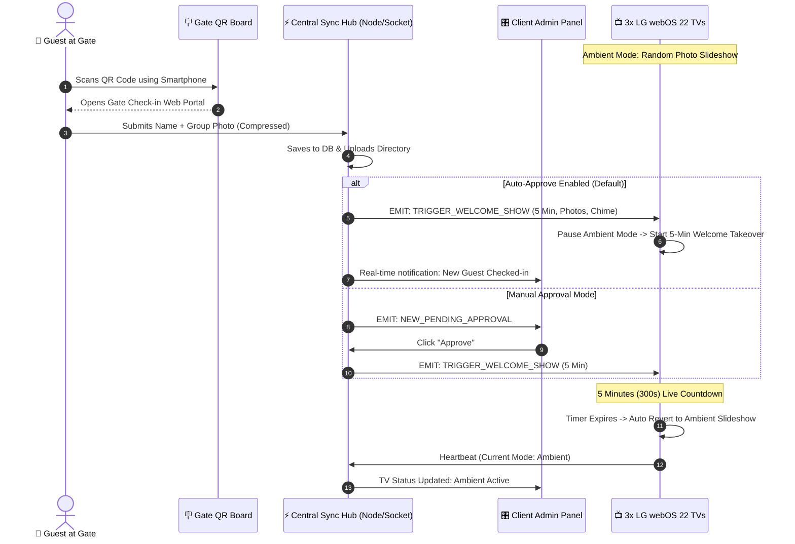

# 📖 01. Project Introduction & System Overview

---

## 1. Executive Summary

Yeh project ek **Luxury Smart Residence Visitor Experience & Multi-TV Display Automation System** hai. Is system ka mukhya uddeshya client ke ghar aane wale guests aur visitors ko ek premium, automated, aur personalized welcome anubhav (experience) pradan karna hai.

Client ke ghar me **3 LG Smart TVs** hain jo **webOS 22 (version 7.0)** operating system run karte hain:
1. **TV 1 (Living Room):** Main entrance aur guest reception area.
2. **TV 2 (Dining Hall):** Formal dining area.
3. **TV 3 (Lounge / Foyer):** Family lounge ya upper seating area.

Jab bhi koi visitor gate par visit karta hai, gate par lage **QR Code** ko scan karke apna naam, mobile number aur host ke sath li hui group photo upload karta hai. Turant **kisi manual intervention ke bina**, teeno TVs par chal raha ambient slideshow pause ho jata hai aur visitor ki photo aur warm welcome announcement **5 minute tak dedicatedly display** hoti hai. 5 minute ke baad TV auto-revert hokar database ki sabhi approved photos ko ambient slideshow me randomly rotate karne lagta hai.

---

## 2. Problem Statement & Real-World Solution

### Purana / Traditional Tareeka (The Friction):
* Guests aate hain toh unka koi digital record nahi rehta.
* TVs par koi boring TV channels ya static wallpapers chalte rehte hain jiska koi personalization value nahi hota.
* Kisi photo ko TV par dikhane ke liye pen-drive lagana, screen mirroring connect karna, ya manual HDMI switch karna padta hai jo cumbersome aur slow hota hai.

### Humara Smart Automated Solution:
* **Zero App Download for Visitors:** Visitor ko koi app download nahi karni padti. Phone camera se QR scan karte hi ultra-fast web page khulta hai.
* **Instant Real-Time Synchronization (<100ms):** Gate par "Submit" dabate hi teeno TVs par WebSockets ke zariye real-time alert trigger hota hai.
* **Smart 5-Minute Priority Queue:** TV par achanak photos nahi badalte; 5 minute ka dedicated luxury welcome countdown chalta hai with pleasant chime.
* **Ambient Memory Wall:** 5 minute ke baad TVs band nahi hote, balki purani sabhi yaadon (photos) ko Ken Burns 4K ambient mode me rotate karte rehte hain.
* **Client Control & Privacy:** Client ke paas ek dedicated Admin Dashboard hota hai jahan se wo live TVs monitor kar sakte hain, unwanted photos delete kar sakte hain, aur manual approval mode toggle kar sakte hain.

---

## 3. High-Level Architecture & Data Flow

---

## 4. The Four Core Pillars of the System

### Pillar 1: Gate Visitor Check-In Portal
* **Technology:** Mobile-first Responsive Web / HTML5 / Canvas Engine.
* **Capabilities:**
  - Client-side image compression (15MB camera captures compressed to ~600KB JPEG in 200ms before sending).
  - Multi-photo capture & upload.
  - No login/sign-up friction.
  - Instant success confirmation banner.

### Pillar 2: Central Real-Time Sync Engine
* **Technology:** Node.js, Express, Socket.io, Multer, Persistent JSON/SQLite.
* **Capabilities:**
  - WebSocket Room & Device Management.
  - Auto-revert timer management (exact 300 seconds).
  - Multi-TV broadcast orchestration.
  - Heartbeat telemetry tracking (online/offline status).

### Pillar 3: webOS 22 Smart TV Display Application
* **Technology:** LG webOS HTML5 Engine, CSS3 3D Hardware Accelerated Transforms, Web Audio API.
* **Capabilities:**
  - Dual-mode architecture: **Priority Welcome Mode** vs **Ambient Slideshow Mode**.
  - Dual-layer cross-dissolve with zero screen tearing or blank white flashes.
  - Ken Burns slow pan/zoom effect to prevent TV panel burn-in.
  - Synthesized luxury welcoming chime.
  - Standalone execution in webOS 22 Simulator & physical LG TVs.

### Pillar 4: Admin Control Hub & Flutter MVVM Portal
* **Technology:** Web Dashboard & Enterprise Flutter Application (Strict MVVM).
* **Capabilities:**
  - 3-TV Realtime Heartbeat Monitor.
  - Auto-Approve vs Manual Moderation Toggle.
  - 1-Click "Force Broadcast to 3 TVs".
  - Instant announcement broadcast ("Dinner is served").
  - Ambient Photo Library Management (Upload/Delete).
