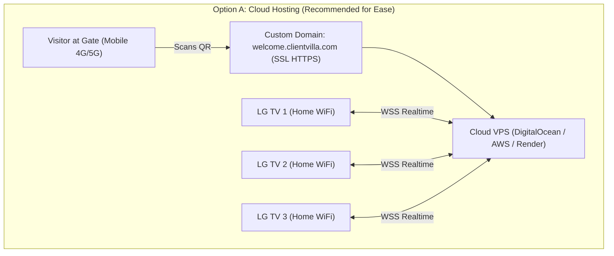

# 🚀 04. Production Deployment & Real LG TV Installation

---

## 1. Hosting Architecture Choices (Real Project Setup)

Jab client ke ghar par system permanently lagana ho, toh hamare paas do sabse behtareen deployment models hain:



### Option A: Cloud Hosting (Recommended)
* **Setup:** Node.js server ko DigitalOcean ($4-$6/month droplet), AWS EC2, ya Render/Railway par host karein.
* **Fayda:**
  - Visitor kisi bhi mobile network (Jio, Airtel, Vi) se QR code scan karke direct connect ho sakta hai.
  - Client jab ghar se bahar ho, tab bhi phone se Admin panel access karke TVs aur visitors monitor kar sakta hai.
* **Domain:** `https://welcome.patelresidence.com`

### Option B: Local Mini PC / Home Server (100% Private LAN)
* **Setup:** Client ke ghar me ek chhota Intel N100 Mini PC ya Raspberry Pi 4/5 lagayein jo 24/7 unke home Wi-Fi router se connected rahe.
* **Fayda:**
  - Zero recurring cloud cost.
  - Ghar ka internet down hone par bhi TVs aur local Wi-Fi par slideshow chalta rahega.
* **Gate QR Access:** Cloudflare Tunnel (`cloudflared`) use karke free me secure public HTTPS URL create kiya ja sakta hai.

---

## 2. Domain & HTTPS SSL Requirements

> [!IMPORTANT]
> **Mobile Camera Permissions:** Safari (iPhone) aur Chrome (Android) me photo capture aur camera access ke liye **HTTPS (SSL)** mandatory hota hai.

1. **Free SSL Setup via Let's Encrypt / Certbot:**
   ```bash
   sudo certbot --nginx -d welcome.patelresidence.com
   ```
2. **Reverse Proxy (Nginx) Configuration:**
   ```nginx
   server {
       server_name welcome.patelresidence.com;

       location / {
           proxy_pass http://localhost:5000;
           proxy_http_version 1.1;
           proxy_set_header Upgrade $http_upgrade;
           proxy_set_header Connection "upgrade";
           proxy_set_header Host $host;
       }

       listen 443 ssl;
       # SSL certificate paths here
   }
   ```

---

## 3. Real LG Smart TV (webOS 22) Par App Install Karne Ke Tareeqe

LG Smart TV par application run karne ke do tareeqe hote hain:

### Method 1: Dedicated Packaged App (`.ipk` File) — *Professional Method*
Is method se TV ke menu me ek permanent app icon ban jata hai.

1. **LG TV Developer Mode Enable Karein:**
   - TV me LG Content Store kholein.
   - **"Developer Mode"** app search karke install karein.
   - App open karke apne LG Developer account se login karein aur "Dev Mode" switch ON karein.
   - Screen par TV ka **IP Address** aur **Passphrase** dikhega.

2. **Computer Par webOS TV CLI Tools Download Karein:**
   - LG Developer site se `webOS TV CLI` download karein.
   - TV ko connect karein:
     ```bash
     ares-setup-device --add my_tv -i 192.168.1.50 -p 9922 -u prisoner
     ```

3. **App Package Karein (`.ipk`):**
   - Hamare `tv_display_webos` folder ko package karein:
     ```bash
     ares-package E:\project\visitor\tv_display_webos
     ```
   - Yeh `com.residence.tvdisplay_1.0.0_all.ipk` file create karega.

4. **TV Par Install Karein:**
   ```bash
   ares-install -d my_tv com.residence.tvdisplay_1.0.0_all.ipk
   ```
   - Teeno TVs par unka IP address daal kar install kar dein.
   - TV ke Home Screen par "Residence Welcome" ka icon aa jayega!

---

### Method 2: TV Web Browser Full-Screen Mode — *Easiest & Quickest*
Agar client developer mode setup nahi karna chahta:

1. LG TV Remote ka **Home** button dabayein aur **Web Browser** open karein.
2. URL enter karein:
   - Living Room TV: `https://welcome.patelresidence.com/tv?tvId=tv1`
   - Dining Hall TV: `https://welcome.patelresidence.com/tv?tvId=tv2`
   - Lounge TV: `https://welcome.patelresidence.com/tv?tvId=tv3`
3. TV remote se browser ke **Full Screen** icon par click karein.
4. Browser menu me **"Add to Bookmarks"** ya **"Set as Startup Page"** select karein.
5. TV on hote hi auto-display start ho jayegi!

---

## 4. 24/7 TV Hardware Health & Panel Protection

LG webOS 22 TVs (visheshkar OLED/NanoCell panels) ko 24 ghante on rakhne par screen burn-in ka khatra ho sakta hai agar static images display kiye jayein. Hamare system me yeh safety built-in hai:

1. **Ken Burns Micro-Panning (No Static Pixels):**
   - CSS3 transform continuous 1.08x scale aur -1% pan movement karti rehti hai. Kisi bhi pixel par static color nahi rehta, jisse screen burn-in ka risk 0% ho jata hai.
2. **Auto Memory Cleanup:**
   - Slideshow memory me unlimited photos store nahi karta; DOM me sirf 2 layers active rehti hain.
3. **Auto-Reconnect with Backoff:**
   - Agar ghar ka Wi-Fi band hota hai, TV blank nahi hogi. Wo already cached photos rotate karti rahegi aur background me silent reconnection try karti rahegi.
